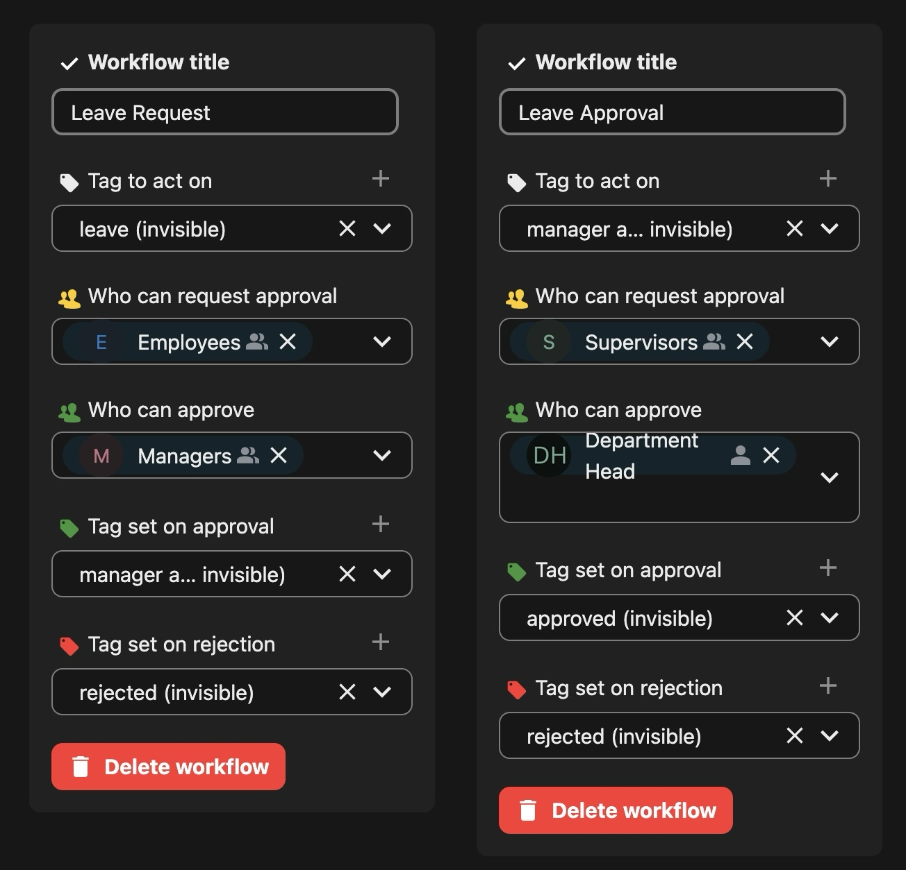
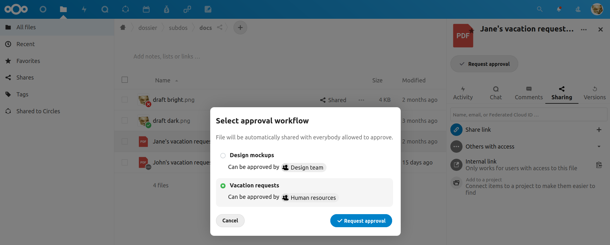
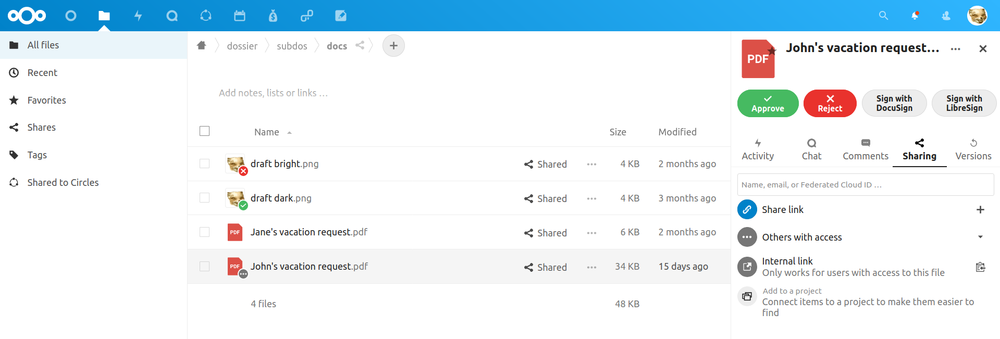
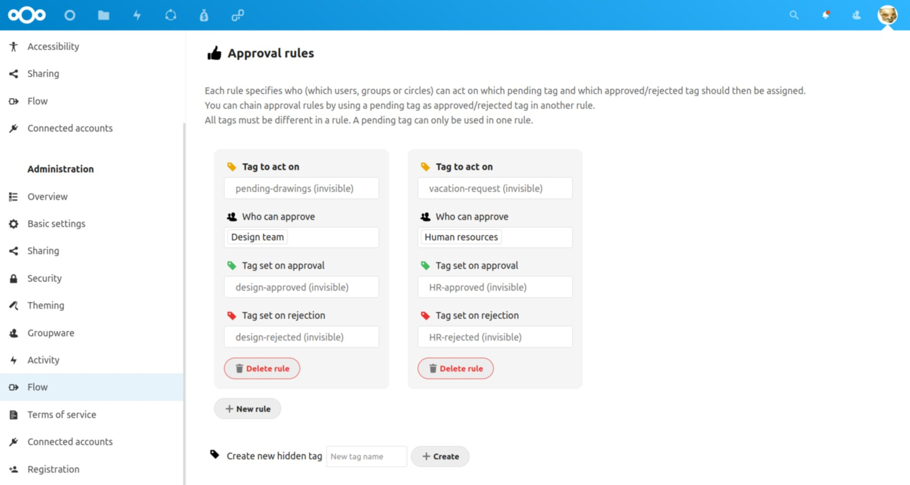

<!--
  - SPDX-FileCopyrightText: 2021 Nextcloud GmbH and Nextcloud contributors
  - SPDX-License-Identifier: AGPL-3.0-or-later
-->
# Files approval

[](https://api.reuse.software/info/github.com/nextcloud/approval)

✔ Approve or reject files/folders.

**Warning**: The DocuSign integration is no longer part of this app
and can be installed with [this app](https://apps.nextcloud.com/apps/integration_docusign).

This app is integrated in the files list (Files app).

Admins can define approval workflows: who can request, who can approve/reject.
Users can then request approval. Authorized users will be able to approve or reject.

## Settings

After installing the app, in Administration settings, there is a section "Approval workflows" where you define workflows.

Workflow definition:

* A workflow title
* A list of users, groups and circles who can request approval
* A list of users, groups and circles who can approve or reject
* A pending tag: the tag meaning approval was requested and elements can be approved or rejected
* An approved tag: the assigned tag when elements get approved
* A rejected tag: the assigned tag when elements get rejected

A pending tag can only be used in one approval workflow.
Workflows can be chained. For example, if the approved tag of a workflow A is used as the pending tag of another workflow B,
then once a file is approved by the workflow A, it becomes pending for the B one. For an example of a chain involving a leave
request that needs to be approved by a manager and then the department head, there is a screenshot below.

**Notice**: If the approvers are a group the file may be shared with the individual users of the group instead of the group.



### Approval threshold

Each workflow has an optional approval threshold, a number greater than 0 and up to 1 (1 means all approvers must approve, 0 is not allowed).
When it is set, a file is approved once the approvals reach that share of the authorized approvers and rejected once the rejections exceed the complementary share.
For example with a threshold of 0.5 and three approvers, two approvals approve the file and two rejections reject it.
The share is computed against the users who can approve the workflow at that moment, including the members of the configured groups and circles.
When the field is left empty, the first decision wins, like before.

**Notice**: In threshold mode each approver can only decide once per file and workflow; notifications and activities are sent only when the final outcome is reached.

The value is stored server-side as an integer number of basis points (one basis point = 0.0001, column `approval_threshold_bp`), while the settings interface and the API keep using a number between 0 and 1 with at most four decimals. Saving from an older interface that does not send the field keeps the current value; saving an empty field clears it and switches the workflow back to first-decision mode. The vote progress shown in the sidebar is computed by the controller when the state is requested, so listing files over WebDAV stays as fast as before.

**Known limitations**:

* The threshold is only evaluated when someone votes. If the approver list or the threshold changes while a file is pending, the file is resolved by the next vote, not automatically.
* The number of approvers is read live on every decision. If group membership changes during a vote, the votes of users who left the group still count while the denominator changes, so the ratio can shift between votes.
* Double votes are checked before the vote is stored; two racing requests can still store a second vote in theory. The user interface re-fetches the latest state before acting and refuses a second vote with a notice, and the server-side check is the backstop. This is accepted for the first version.
* A threshold of 1 means every approver must approve, and any single rejection already decides the file, because one rejection is always greater than 1 − 1 = 0: unanimity includes an immediate veto.
* The stored value is an integer number of basis points, so only multiples of 0.0001 are exact; every value the interface can enter (steps of 0.01) is unaffected.

## Tag assignment

There are 3 ways to assign a hidden tag to a file/folder:

* Click the "Request approval" button in Files sidebar
* Admins can see and use hidden tags like classic tags. So they can be manually assigned.
* Via the [Files Automated Tagging](https://github.com/nextcloud/files_automatedtagging) App

## Build

Just run:
```
make dev
```
or for production:
```
make build
```

Release tarballs are hosted at [https://github.com/nextcloud-releases/calendar/releases](https://github.com/nextcloud-releases/approval).

## Screenshots




